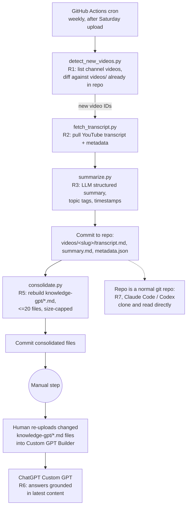

# Pipeline architecture (Option C)

- Steps A-G run unattended on GitHub Actions; a failed step surfaces as a failed workflow run (notification via GitHub's default email/Actions UI — no extra tooling built for this).
- Step H-I is the only manual action in the whole loop, forced by the Constraints (no Knowledge-upload API).
- R7 (agent access) needs no separate pipeline step: it is satisfied by the repo's existence and structure alone.

## Amendment 2026-10-11: $0 hybrid (supersedes step D as CI-only)

- Step D (`summarize`) has two runners writing the same `summary.md`: CI with Gemini free tier for the weekly video; local `./review-batch` with `claude -p` for backlog and re-summaries.
- CI never uses the subscription login. Local runs commit and push; CI validates (step E gate) before consolidation (F).
- Queue order is newest first. Re-running either runner skips videos that already have a valid summary.
